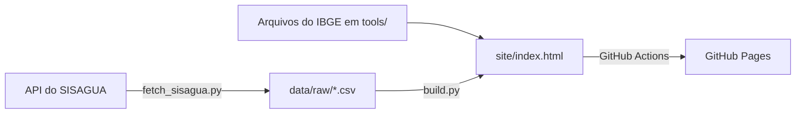

# Água em Alagoas

[](https://github.com/LUCASEPITACIO12/agua-em-alagoas/actions/workflows/atualizar.yml)

Painel sobre a qualidade da água para consumo humano nos 102 municípios de Alagoas, feito a partir das amostras de **vigilância** do [SISAGUA](https://www.gov.br/saude/pt-br/composicao/svsa/saude-ambiental/vigiagua) (Ministério da Saúde), de 2014 até hoje.

**Painel publicado:** https://lucasepitacio12.github.io/agua-em-alagoas/

O painel mostra quatro parâmetros: cloro residual livre, turbidez, coliformes totais e *Escherichia coli*. Os resultados podem ser vistos por município, mês e tipo de abastecimento, em mapa e em tabela.

## Como funciona



1. `tools/fetch_sisagua.py` baixa as amostras de Alagoas da API de dados abertos do Ministério da Saúde e grava um CSV por ano em `data/raw/`.
2. `tools/build.py` trata e agrega os dados por mês, cruza os municípios com o IBGE e gera um único arquivo, `site/index.html`, a partir de `tools/template.html`.
3. O workflow [`atualizar.yml`](.github/workflows/atualizar.yml) faz os dois passos e publica o site no GitHub Pages **nos dias 1 e 16 de cada mês**, às 6h de Brasília.

Se a API falhar ou faltar algum ano, o build para e o site anterior continua no ar.

## Estrutura do repositório

| Caminho | O que é |
|---|---|
| `tools/fetch_sisagua.py` | Baixa as amostras da API do SISAGUA |
| `tools/build.py` | Trata os dados e gera o site |
| `tools/template.html` | Modelo da página (HTML, CSS e JavaScript) |
| `tools/compare_csv.py` | Confere a API contra o CSV oficial de um ano |
| `tools/municipios.json` | Lista dos municípios de Alagoas, do IBGE |
| `tools/27` | Malha (limites) dos municípios de Alagoas, do IBGE, em GeoJSON |
| `.github/workflows/atualizar.yml` | Atualização e publicação automáticas |

A API do IBGE não responde aos servidores do GitHub, então os dois arquivos do IBGE ficam salvos no repositório. Se eles forem apagados, o build tenta baixá-los e falha no GitHub Actions. Para atualizá-los, baixe de novo pelos links abaixo e substitua os arquivos com os mesmos nomes:

- [Lista de municípios](https://servicodados.ibge.gov.br/api/v1/localidades/estados/27/municipios) → `tools/municipios.json`
- [Malha dos municípios](https://servicodados.ibge.gov.br/api/v3/malhas/estados/27?intrarregiao=municipio&qualidade=minima&formato=application/vnd.geo%2Bjson) → `tools/27`

## Gerar localmente

Só é preciso Python 3. O projeto usa apenas a biblioteca padrão, sem nada para instalar.

```bash
python tools/fetch_sisagua.py
```

```bash
python tools/build.py
```

Depois, abra `site/index.html` no navegador.

O primeiro download leva de 30 a 50 minutos. Nas vezes seguintes, só os dois anos mais recentes são baixados de novo, porque o SISAGUA recebe registros com atraso. Use `python tools/fetch_sisagua.py --all` para baixar tudo outra vez.

## Fonte e tratamento dos dados

**Fonte:** API [`apidadosabertos.saude.gov.br/sisagua/vigilancia-parametros-basicos`](https://apidadosabertos.saude.gov.br/sisagua/vigilancia-parametros-basicos), com 1.000 linhas por página. Para 2018, as contagens e as chaves das amostras bateram integralmente com o CSV oficial (verificado com `tools/compare_csv.py`).

### Critérios (Portaria GM/MS nº 888/2021)

| Parâmetro | Padrão | Referência |
|---|---|---|
| Cloro residual livre | mínimo de 0,2 mg/L | art. 32 |
| Cloro residual livre | máximo de 5 mg/L | Anexo 9 |
| Turbidez | até 5 uT | art. 28, § 2º, e Anexo 11 |
| *Escherichia coli* | ausente | Anexo 1 |

**Categorias do cloro no painel:**

| Categoria | Faixa |
|---|---|
| Insuficiente | abaixo de 0,2 mg/L |
| Adequado | de 0,2 a 2,0 mg/L |
| Alerta | acima de 2,0 até 5,0 mg/L |
| Acima do máximo | acima de 5 mg/L |

O limite de 2 mg/L é um critério do painel, não da portaria. Amostras em "Alerta" não contam como fora do padrão.

### O que fica de fora

- Coletas que não são de rotina.
- Água bruta, coletada na captação.
- Duplicatas exatas.
- Resultados ilegíveis.
- Cloro acima de 20 mg/L e turbidez acima de 1.000 uT. Esses tetos são decisões do painel para isolar prováveis erros de digitação.

As exclusões são contadas e informadas no próprio painel.

### Outras decisões

- O número da amostra não identifica a amostra sozinho, porque se repete entre municípios e datas. A chave usa também o município, a data e a hora da coleta, a forma de abastecimento e o resultado.
- `codigo_ibge` vem vazio em boa parte dos anos, então o município é identificado pelo nome e cruzado com a lista do IBGE.
- A opção "SAA: rede de distribuição e estação de tratamento" usa as amostras de SAA com procedência `SISTEMA DE DISTRIBUIÇÃO` ou `ESTAÇÃO DE TRATAMENTO DE ÁGUA`. Continua sendo vigilância do setor saúde e não avalia cada prestador.
- Coliformes totais aparecem como percentual de amostras com presença, sem julgar conformidade, porque a tolerância da norma depende do sistema e do mês.
- Os meses mais recentes são marcados como provisórios, porque o SISAGUA ainda recebe registros deles.
- Municípios com menos de 30 amostras no período ficam hachurados no mapa e no fim da tabela.

## Limitações

- Os dados são da **vigilância** feita pelo setor saúde, não do **controle** feito pelas empresas de abastecimento. Uma amostra mostra a água naquele ponto e momento, não a situação de todo o município.
- A qualidade do painel depende do que os municípios registram no SISAGUA. Municípios com poucas amostras têm resultados menos confiáveis.
